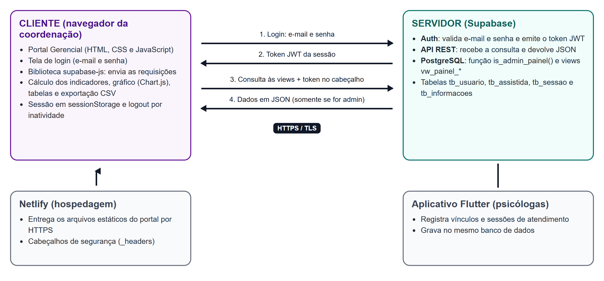
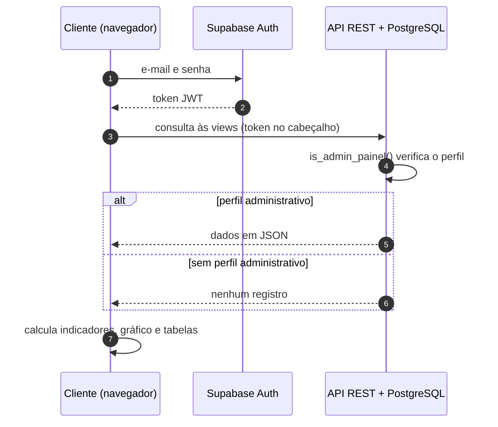
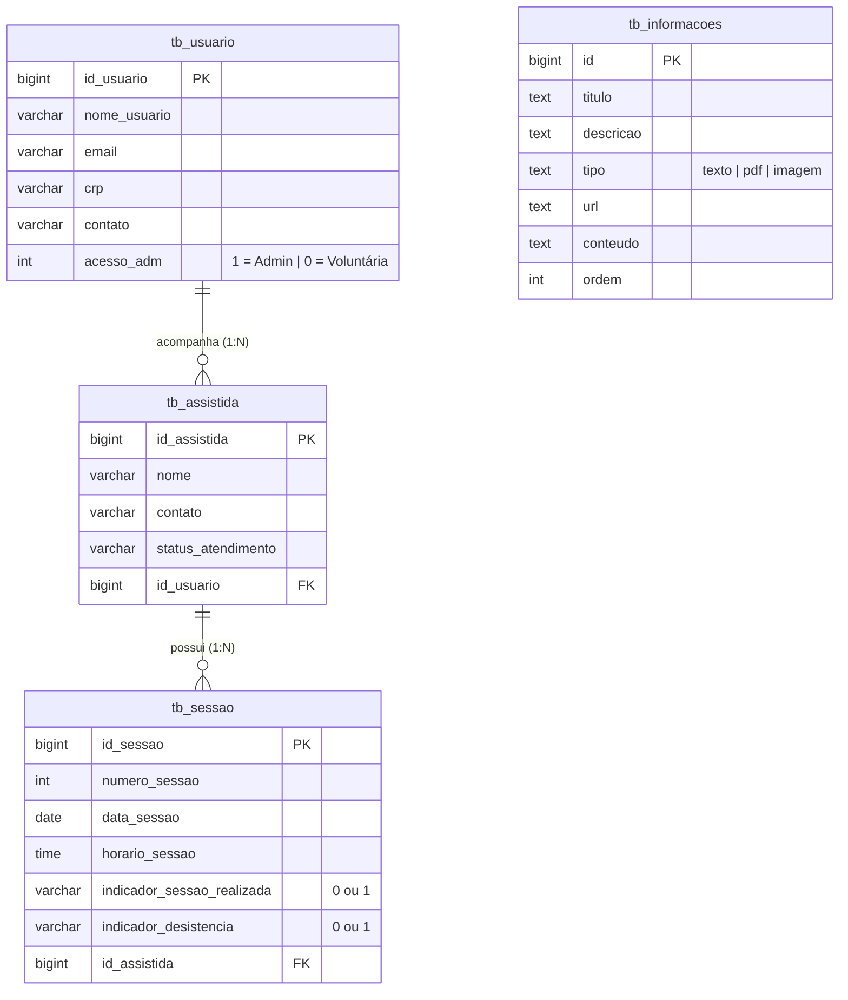
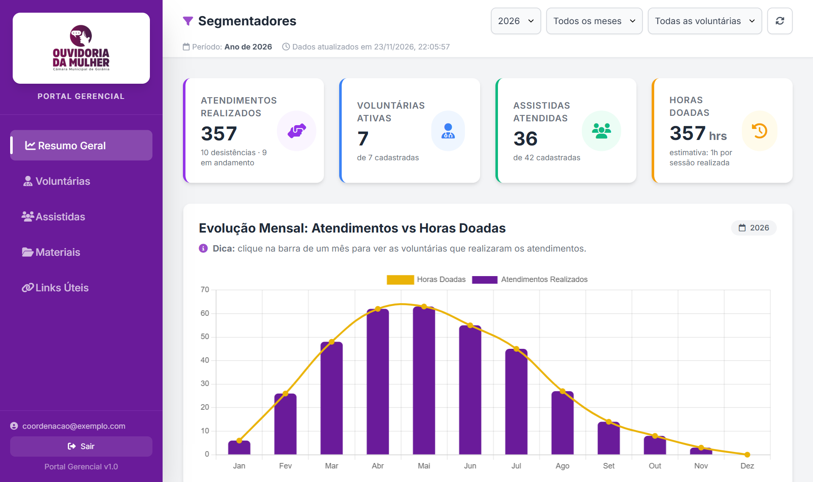
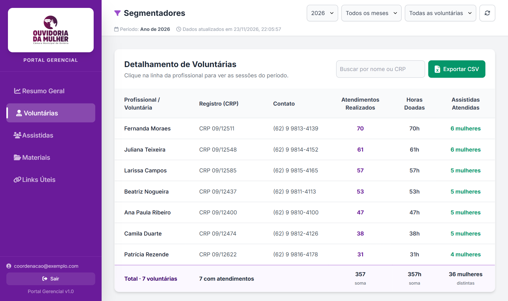
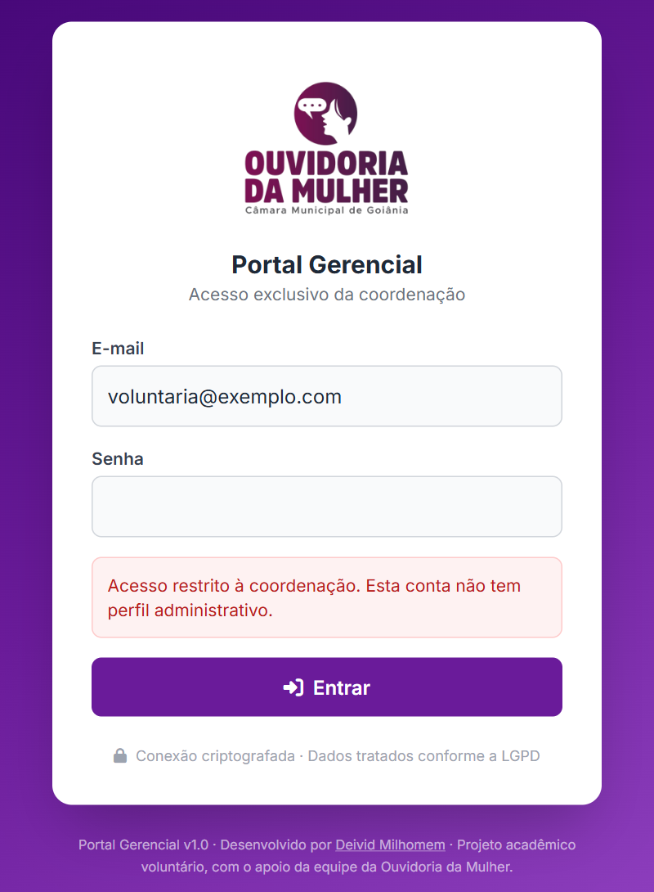
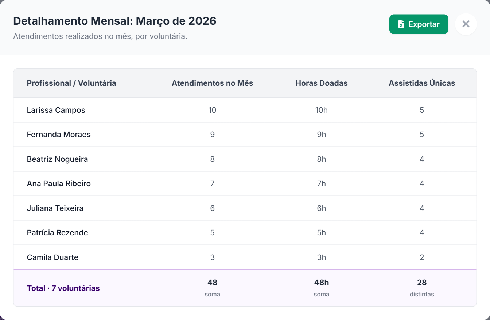
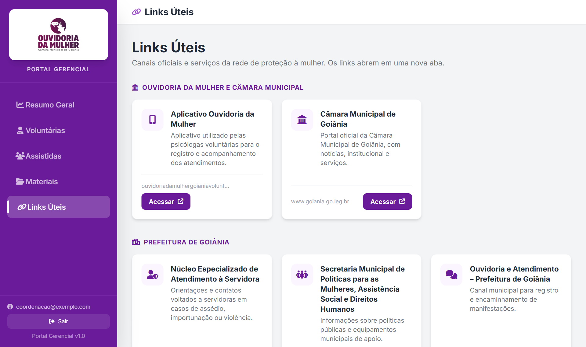

<p align="center">
  
</p>

<h1 align="center">Portal Gerencial da Ouvidoria da Mulher</h1>

<p align="center">
  <b>Projeto Integrador III-A</b> · Tecnólogo em Análise e Desenvolvimento de Sistemas<br>
  Pontifícia Universidade Católica de Goiás (PUC Goiás) · Coordenação de Educação a Distância (CEAD)<br>
  Aluno: <b>Deivid Milhomem dos Santos</b> · Professor: <b>Thalles Bruno G. N. dos Santos</b> · Goiânia, 2026
</p>

<p align="center">
  
  
  
  
  
  
</p>

Este repositório reúne o código-fonte, os scripts de banco de dados e a documentação do **Portal Gerencial**. Trata-se de uma aplicação web cliente-servidor que permite à coordenação da Ouvidoria da Mulher da Câmara Municipal de Goiânia consultar, de forma consolidada e segura, os atendimentos do programa de voluntariado psicológico.

O conteúdo segue a mesma estrutura do relatório técnico entregue na disciplina.

## Sumário

1. [Identificação da instituição](#1-identificação-da-instituição)
2. [Problema identificado](#2-problema-identificado)
3. [Solução desenvolvida](#3-solução-desenvolvida)
   - [3.1 Funcionalidades](#31-funcionalidades)
   - [3.2 Arquitetura cliente-servidor](#32-arquitetura-cliente-servidor)
   - [3.3 Mecanismos de segurança](#33-mecanismos-de-segurança)
4. [Resultados](#4-resultados)
5. [Considerações finais](#5-considerações-finais)
6. [Como executar](#6-como-executar)
7. [Estrutura do repositório](#7-estrutura-do-repositório)
8. [Referências](#8-referências)

---

## 1. Identificação da instituição

| | |
|---|---|
| **Instituição** | Ouvidoria da Mulher da Câmara Municipal de Goiânia |
| **Área de atuação** | Acolhimento, escuta e encaminhamento de mulheres em situação de violência de gênero |
| **Programa atendido** | Voluntariado de psicólogas que oferecem psicoterapia individual gratuita |

A Ouvidoria é um órgão do Poder Legislativo municipal. Foi criada em 2013 como Ouvidoria Especial da Mulher (Projeto de Resolução nº 7, de 16 de abril de 2013), voltada inicialmente às servidoras da Câmara. Em 2021 foi reestruturada: passou a atender todas as mulheres da comunidade goianiense e instituiu uma central de acolhimento psicológico.

O programa de voluntariado foi formalizado em agosto de 2021. Nele, psicólogas e advogadas atendem gratuitamente mulheres de baixa renda vítimas de violência, acolhidas e encaminhadas pela Ouvidoria. As psicólogas realizam psicoterapia individual em sessões acompanhadas pela coordenação do programa.

---

## 2. Problema identificado

Até o início da parceria, o controle dos atendimentos era feito com formulários on-line e anotações em bloco de texto. Em projetos integradores anteriores foi desenvolvido um [aplicativo em Flutter](https://ouvidoriadamulhergoianiavoluntariado.netlify.app/), ligado a um banco PostgreSQL no Supabase. Nele, cada psicóloga vincula suas assistidas e registra as sessões realizadas, em andamento ou com desistência. Durante este trabalho, a base já reunia **cerca de 780 sessões**.

Os dados existiam, mas não havia uma forma simples de consultá-los de maneira consolidada. A tela administrativa do aplicativo oferece apenas um resumo, e consultar o banco diretamente exige conhecimento técnico. A coordenação levantou três demandas:

- acompanhar a evolução dos atendimentos ao longo do ano;
- responder a auditorias e pesquisas com números confiáveis;
- levantar, por psicóloga, os atendimentos e as horas doadas, que servem de base para o reconhecimento anual do trabalho voluntário.

**Justificativa da solução:** a proposta foi um portal web restrito à coordenação, que consulta o mesmo banco do aplicativo. Essa escolha tem quatro vantagens:

- não duplica dados;
- não muda a rotina das voluntárias;
- funciona no navegador, sem instalação;
- pode ser hospedado gratuitamente.

Antes da implementação, um protótipo com dados simulados ([`mvp.html`](mvp.html)) foi apresentado à coordenação e aprovado. Foi nele que se definiram, em conjunto, as informações que o portal deveria disponibilizar.

---

## 3. Solução desenvolvida

### 3.1 Funcionalidades

O portal é uma aplicação de página única em HTML e JavaScript. Depois do login, a coordenadora tem acesso a:

| Área | O que oferece |
|---|---|
| **Resumo Geral** | Atendimentos realizados, voluntárias ativas, assistidas atendidas e horas doadas. Traz um gráfico mensal; ao clicar em um mês, abre o detalhamento por voluntária. |
| **Voluntárias** | Tabela do período com busca, linha de total e histórico de sessões ao clicar na linha. |
| **Assistidas** | Tabela do período com busca, linha de total, situação atual e histórico de sessões. |
| **Materiais** | Informativos publicados na Central de Apoio do aplicativo (texto, PDF e imagem). |
| **Links Úteis** | Atalhos para canais oficiais da rede de proteção à mulher, como o Ligue 180, a Prefeitura de Goiânia e a Polícia Civil de Goiás. |

**Recursos comuns às telas:**
- filtros de **ano, mês e voluntária**;
- exportação em **CSV** compatível com o Excel (separador `;` e acentuação correta);
- versão adaptada para celular.

**Regras de cálculo:**

| Indicador | Regra |
|---|---|
| Situação da sessão | `indicador_desistencia = 1` vale **Desistência**; `indicador_sessao_realizada = 1` vale **Realizada**; os demais casos valem **Em andamento** |
| Horas doadas | Sessões realizadas × `HORAS_POR_SESSAO` (padrão de 1 hora, configurável em `config.js`), porque o banco não possui campo de duração |
| Situação da assistida | Deduzida da última sessão registrada: Desistência, Em acompanhamento ou Sem sessões |

### 3.2 Arquitetura cliente-servidor

| Papel | Componente | Responsabilidade |
|---|---|---|
| **Cliente** | Navegador da coordenadora | Exibe a interface, envia as requisições e calcula os indicadores, o gráfico e as tabelas |
| **Servidor** | Supabase | Autenticação (Auth), API REST sobre o PostgreSQL e banco de dados compartilhado com o aplicativo |
| Hospedagem | Netlify | Entrega os arquivos estáticos do portal por HTTPS |

<p align="center">
  <br>
  <sub><b>Figura 1:</b> Arquitetura cliente-servidor do Portal Gerencial. Fonte: elaborado pelo autor (2026).</sub>
</p>

**Fluxo de comunicação.** Toda a troca de mensagens acontece por HTTPS (TLS):



No servidor foram criadas três **views**:
- `vw_painel_sessoes`
- `vw_painel_voluntarias`
- `vw_painel_assistidas`

Elas entregam cada sessão já associada à assistida, à voluntária, ao período e à situação. Os cálculos ficam no cliente, o que permite combinar os filtros sem fazer novas consultas. Como a API devolve no máximo mil linhas por requisição, a leitura é **paginada**.

<details>
<summary><b>Modelo de dados utilizado</b> (clique para expandir)</summary>


</details>

### 3.3 Mecanismos de segurança

A comunicação entre cliente e servidor é protegida por **HTTPS/TLS**, fornecido pelo Netlify e pelo Supabase. Sobre esse canal, a biblioteca `supabase-js` cuida da autenticação e envia o **token JWT**, que tem validade limitada e é renovado automaticamente.

A autorização **não depende só da interface**. A função `is_admin_painel()`, executada no próprio banco, confere se o e-mail presente no token pertence a um usuário com `acesso_adm = 1`. As views só devolvem registros quando isso é verdade.

| Camada | Mecanismo | Risco mitigado |
|---|---|---|
| Comunicação | HTTPS (TLS) e token JWT com prazo de validade | Interceptação ou alteração dos dados em trânsito |
| Autenticação | Login com e-mail e senha no Supabase Auth, com cadastro público desativado | Acesso por pessoas não autorizadas |
| Autorização | `is_admin_painel()` dentro das views e revogação do acesso anônimo (`anon`) | Leitura dos dados sem perfil de gestão |
| Sessão | `sessionStorage` e saída automática após 30 minutos sem uso | Uso indevido em computador compartilhado |
| Interface | Escape dos textos do banco, links restritos a http/https e política CSP | Injeção de scripts (XSS) |
| Exportação | Neutralização de fórmulas nas células do CSV | Execução de comandos ao abrir no Excel |
| Hospedagem | Cabeçalhos de segurança ([`_headers`](painel-bi/_headers)) e bloqueio de indexação | Clickjacking e exposição em buscadores |

> **Credenciais:** o código publicado contém apenas a chave **pública** (`anon`) do Supabase, que por concepção pode ficar no cliente. A senha do banco e a chave `service_role` **nunca** fazem parte do repositório. O sistema não armazena dados clínicos: guarda apenas o nome e o telefone das assistidas e dados profissionais públicos das psicólogas (CRP).

---

## 4. Resultados

### 4.1 Evidências do funcionamento

> As capturas abaixo foram feitas em um **ambiente de demonstração com dados fictícios**. Assim, nomes e telefones reais de assistidas e voluntárias não aparecem neste repositório, em respeito à LGPD. Com o banco real, o funcionamento foi conferido junto à coordenação.

<p align="center">
  <br>
  <sub><b>Figura 2:</b> Resumo Geral com indicadores e evolução mensal.</sub>
</p>

<p align="center">
  <br>
  <sub><b>Figura 3:</b> Detalhamento de voluntárias com linha de total.</sub>
</p>

<table align="center">
  <tr>
    <td align="center"></td>
    <td align="center"></td>
  </tr>
  <tr>
    <td align="center"><sub>(a) Conta sem perfil administrativo</sub></td>
    <td align="center"><sub>(b) Detalhamento mensal por voluntária</sub></td>
  </tr>
</table>
<p align="center"><sub><b>Figura 4:</b> Controle de acesso e detalhamento mensal.</sub></p>

<p align="center">
  <br>
  <sub><b>Figura 5:</b> Página de Links Úteis.</sub>
</p>

**Testes realizados:**
- login com senha incorreta;
- acesso com conta sem perfil administrativo;
- consulta às views sem autenticação, que retorna vazia;
- textos com código HTML e links maliciosos gravados de propósito, que aparecem apenas como texto;
- abertura dos CSV no Excel;
- comparação dos totais do portal com contagens feitas diretamente no Supabase.

### 4.2 Demonstração à instituição

- **Protótipo:** a versão com dados simulados foi apresentada à coordenação e aprovada como referência de conteúdo e de layout.
- **Versão funcional:** já conectada ao banco real, foi demonstrada em **[DATA]**, **[presencialmente / on-line]**, para **[NOME E FUNÇÃO DA(S) REPRESENTANTE(S)]**. A apresentação mostrou o login, as abas, os filtros, os detalhamentos e a exportação das planilhas.
- **Ajustes incorporados na validação:**
  - linha de total nas tabelas;
  - correção da visualização de materiais que têm texto e link ao mesmo tempo;
  - página de Links Úteis;
  - logo institucional;
  - animações de navegação.
- **Considerações da instituição:** **[REGISTRAR AS CONSIDERAÇÕES DA INSTITUIÇÃO]**

---

## 5. Considerações finais

**Resultados alcançados.** Informações que antes dependiam de consultas técnicas ao banco passaram a estar disponíveis em poucos cliques, com filtros, totais e exportação. Isso apoia auditorias, pesquisas e o reconhecimento anual das voluntárias. O projeto aplicou conceitos das duas disciplinas do módulo:
- **Sistemas de Computação:** modelo cliente-servidor, ciclo de requisição e resposta HTTP, troca de dados em JSON e divisão do processamento.
- **Segurança da Informação:** criptografia do canal, autenticação, autorização no servidor e defesa em camadas.

**Dificuldades encontradas:**
- O primeiro contato com os recursos de segurança do Supabase (views, permissões por papel e funções no banco) exigiu estudo e vários testes.
- O aplicativo usa apenas o e-mail para entrar, sem senha, para reduzir a resistência das voluntárias. Por isso não foi possível ativar o RLS nas tabelas sem interromper o app, e a proteção foi concentrada nas views do portal. As tabelas originais continuam acessíveis pela chave pública, limitação conhecida pela coordenação.
- A sessão se liga à voluntária apenas pela assistida. Por isso, transferir uma assistida altera o histórico atribuído a cada psicóloga.

**Melhorias futuras:**
- [ ] Login com senha no aplicativo e RLS em todas as tabelas
- [ ] Gravar a voluntária diretamente em cada sessão (`id_usuario` em `tb_sessao`)
- [ ] Campo de duração real dos atendimentos
- [ ] Datas de criação e de alteração para trilha de auditoria
- [ ] Geração automática dos certificados anuais de reconhecimento

---

## 6. Como executar

### Pré-requisitos

| Item | Observação |
|---|---|
| Projeto no Supabase | O mesmo usado pelo aplicativo Flutter, com as tabelas do modelo de dados acima |
| Navegador atual | Chrome, Edge ou Firefox |
| Python 3 (opcional) | Somente para rodar um servidor local de teste |

### Passo a passo resumido

1. **Banco de dados:** no Supabase, abra **SQL Editor**, cole o conteúdo de [`supabase/01_painel_views.sql`](supabase/01_painel_views.sql) e clique em **Run**. O script não altera as tabelas existentes.
2. **Conta da coordenação:**
   - Em **Authentication → Sign In / Providers**, desative **"Allow new users to sign up"**.
   - Em **Authentication → Users → Add user**, crie a conta com o **mesmo e-mail** que tem `acesso_adm = 1` em `tb_usuario` e marque **Auto Confirm User**.
3. **Conferência (opcional):** rode os blocos de [`supabase/02_verificacao.sql`](supabase/02_verificacao.sql) para simular o acesso da administradora e de uma conta comum.
4. **Configuração:** em [`painel-bi/assets/config.js`](painel-bi/assets/config.js), informe `SUPABASE_URL` e `SUPABASE_ANON_KEY`. Os dois estão em **Project Settings → API**.
5. **Execução local:** dentro da pasta `painel-bi`, rode

   ```bash
   python -m http.server 8080
   ```

   Depois acesse <http://localhost:8080>. Abrir o `index.html` com dois cliques não funciona, por causa da política de segurança (CSP).
6. **Publicação:** no Netlify, vá em **Add new site → Deploy manually** e arraste a pasta `painel-bi` inteira.

O passo a passo detalhado, com o caminho de cada menu, solução de problemas e riscos registrados, está em [`GUIA_IMPLANTACAO.md`](GUIA_IMPLANTACAO.md).

---

## 7. Estrutura do repositório

```
.
├── painel-bi/                    # Aplicação (cliente), pasta publicada no Netlify
│   ├── index.html                # Tela de login + 5 abas do portal
│   ├── _headers                  # Cabeçalhos de segurança do Netlify
│   └── assets/
│       ├── app.js                # Login, consultas, indicadores, gráfico, totais e CSV
│       ├── config.js             # URL e chave pública do Supabase; parâmetros
│       ├── links-uteis.js        # Lista editável da página Links Úteis
│       ├── tailwind.config.js    # Paleta institucional
│       └── logo.png              # Logo da Ouvidoria da Mulher
├── supabase/                     # Servidor: scripts SQL
│   ├── 01_painel_views.sql       # Função is_admin_painel() e views do painel
│   └── 02_verificacao.sql        # Consultas de conferência (somente leitura)
├── docs/img/                     # Capturas de tela (dados fictícios) e diagrama
├── GUIA_IMPLANTACAO.md           # Guia detalhado de implantação
├── mvp.html                      # Protótipo aprovado pela instituição
├── erDiagram.md                  # Modelo de dados
└── README.md
```

---

## 8. Referências

- BRASIL. **Lei nº 13.709, de 14 de agosto de 2018.** Lei Geral de Proteção de Dados Pessoais (LGPD). Disponível em: <https://www.planalto.gov.br/ccivil_03/_ato2015-2018/2018/lei/l13709.htm>. Acesso em: 23 nov. 2026.
- CÂMARA MUNICIPAL DE GOIÂNIA. **Ouvidoria da Mulher.** Disponível em: <https://www.goiania.go.leg.br/institucional/organograma/ouvidoria-da-mulher>. Acesso em: 23 nov. 2026.
- CHART.JS. **Chart.js documentation.** Disponível em: <https://www.chartjs.org/docs/latest/>. Acesso em: 23 nov. 2026.
- KUROSE, James F.; ROSS, Keith W. **Redes de computadores e a Internet:** uma abordagem top-down. 8. ed. São Paulo: Pearson, 2021.
- MDN WEB DOCS. **Content Security Policy (CSP).** Disponível em: <https://developer.mozilla.org/pt-BR/docs/Web/HTTP/CSP>. Acesso em: 23 nov. 2026.
- NETLIFY. **Custom headers.** Disponível em: <https://docs.netlify.com/routing/headers/>. Acesso em: 23 nov. 2026.
- OUVIDORIA DA MULHER. **Aplicativo Ouvidoria da Mulher.** Disponível em: <https://ouvidoriadamulhergoianiavoluntariado.netlify.app/>. Acesso em: 23 nov. 2026.
- OWASP FOUNDATION. **Cross Site Scripting Prevention Cheat Sheet.** Disponível em: <https://cheatsheetseries.owasp.org/cheatsheets/Cross_Site_Scripting_Prevention_Cheat_Sheet.html>. Acesso em: 23 nov. 2026.
- STALLINGS, William; BROWN, Lawrie. **Segurança de computadores:** princípios e práticas. 2. ed. Rio de Janeiro: Elsevier, 2014.
- SUPABASE. **Auth.** Disponível em: <https://supabase.com/docs/guides/auth>. Acesso em: 23 nov. 2026.
- SUPABASE. **Row Level Security.** Disponível em: <https://supabase.com/docs/guides/database/postgres/row-level-security>. Acesso em: 23 nov. 2026.

---

<p align="center">
  <sub>Projeto acadêmico voluntário, desenvolvido por <a href="https://www.linkedin.com/in/deivid-milhomem-ba7777135/">Deivid Milhomem</a> com o apoio da equipe da Ouvidoria da Mulher da Câmara Municipal de Goiânia.</sub>
</p>
